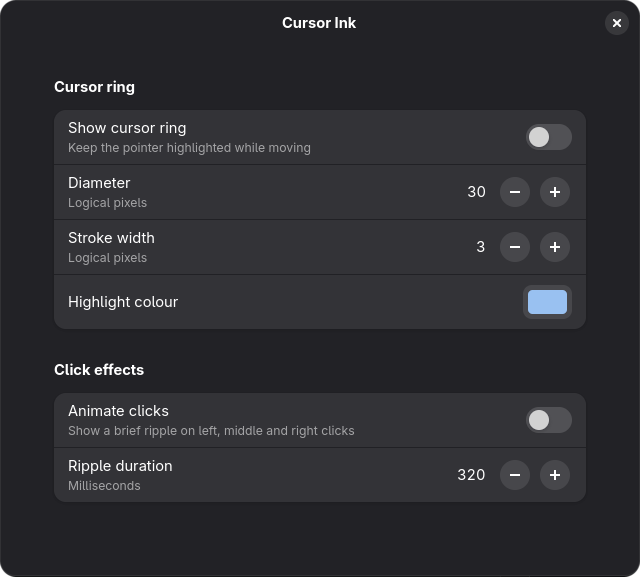

[](https://extensions.gnome.org/)

#  Cursor Ink for GNOME Shell

Cursor Ink adds a ring around your pointer and a fading ripple when you click.
It makes the mouse easier to follow during presentations and screen recordings.

You can change the ring size, width and colour, adjust the ripple duration,
or turn either effect off in the extension preferences.



## Compatibility

Targets GNOME Shell 48–51. Tested on GNOME Shell 51.1 with Wayland.

## Installation

Install from [GNOME Extensions](https://extensions.gnome.org/)
(recommended once published).

Or install directly from this repository:

```bash
cd /tmp
git clone https://github.com/michaelknap/cursor-ink.git
cd cursor-ink
./install.sh
```

The script copies the extension to your local GNOME extensions directory and
compiles its settings schema. Run it as your normal user, without sudo.
It needs the GLib tools (`glib-compile-schemas`).

Log out and back in, then enable Cursor Ink in the Extensions app.
Open its preferences there to customise it.

## License

MIT. See [LICENSE](LICENSE).
